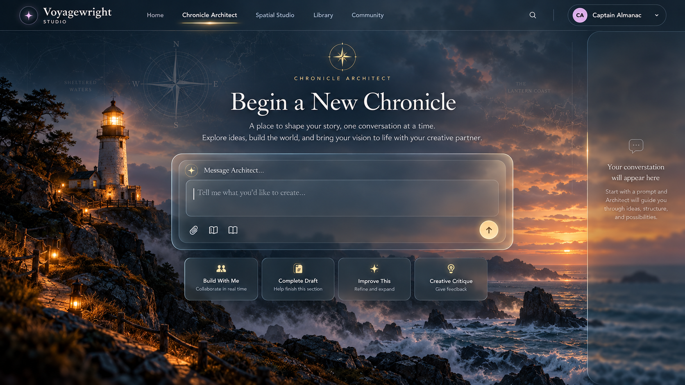
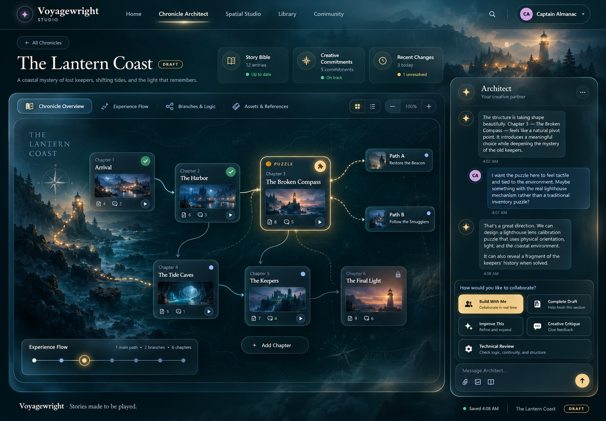
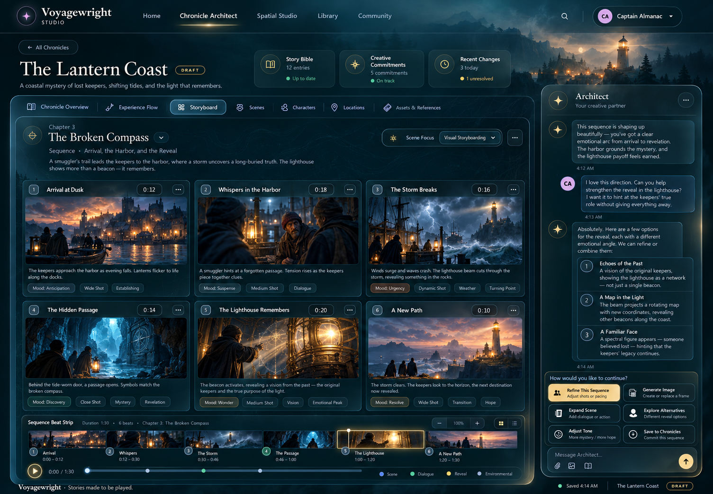
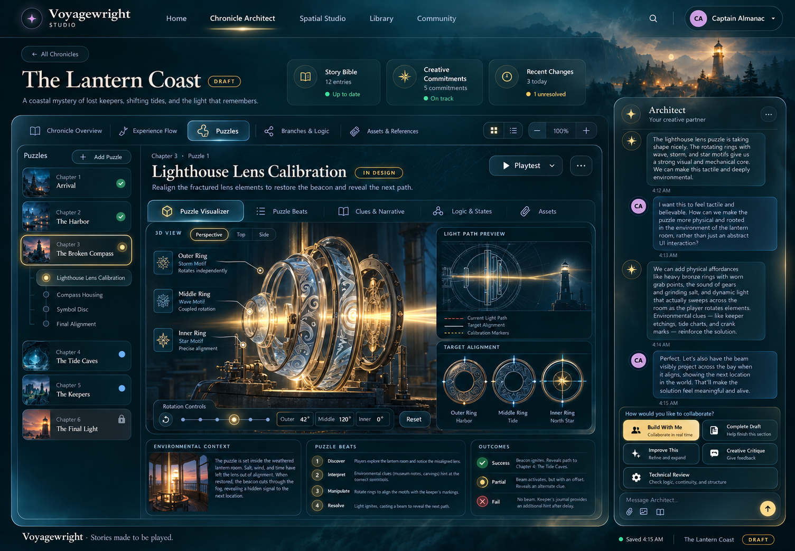
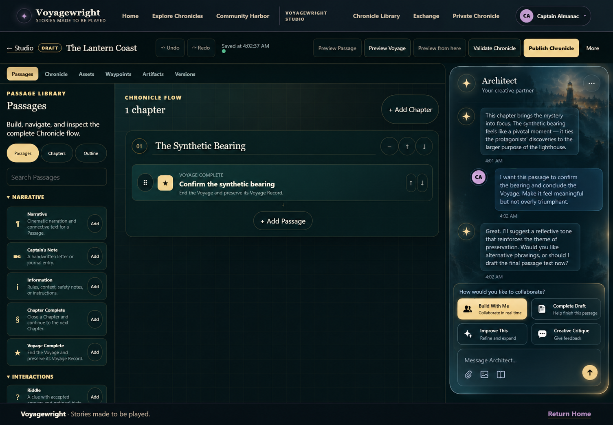
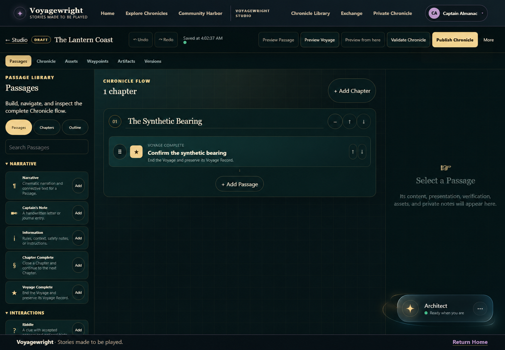
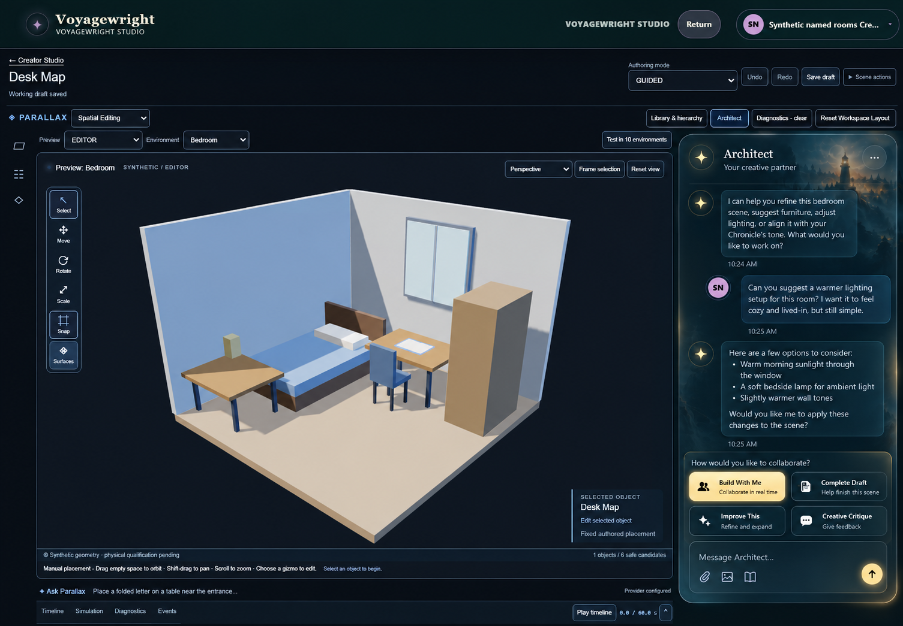
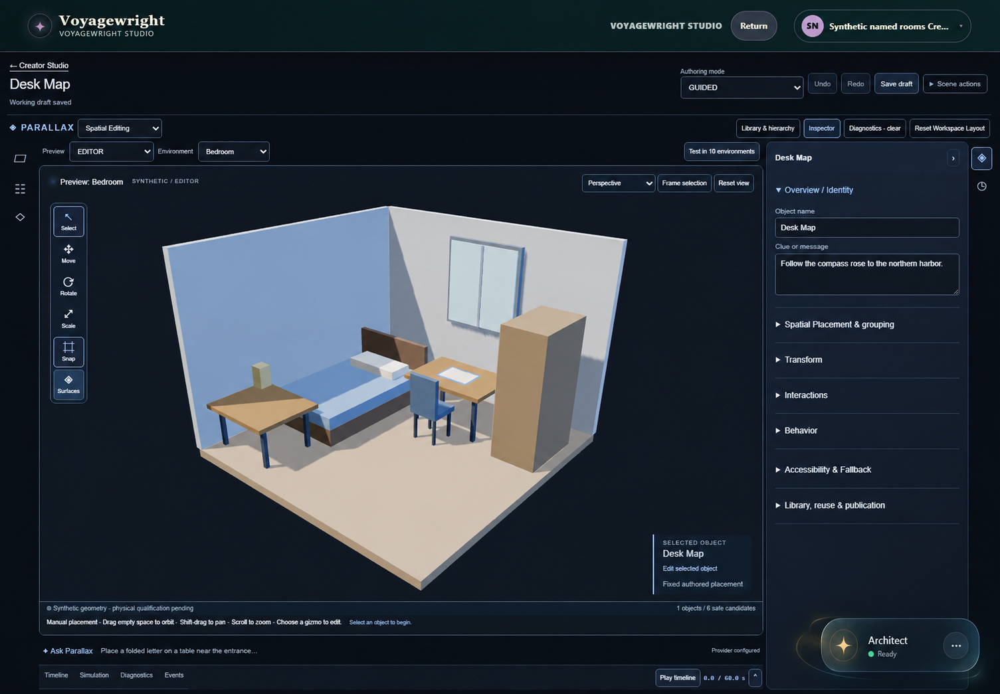

# SC-05 original Architect visual references

All ten owner-provided original PNGs are preserved byte for byte. See the [authoritative SHA-256 manifest and Git blob identities](../SC05_Architect_Visual_Reference_Asset_Manifest_v1.0.md) for integrity, provenance and the full interaction contract. The two backgrounds are actual required image layers; the other eight images are proposed screen concepts. No image is regenerated, substituted or flattened into an implemented UI.

**Draft documentation only.** These previews do not claim implementation, product acceptance or distribution rights beyond the requested repository import. [SC-05 governing specification](../Project_Chronicle_Architect_Governing_Document_v1.0.md), [SC roadmap](../Voyagewright_Spatial_Chronicle_Creation_Program_Roadmap_v1.0.md), [Creator Experience amendment](../Voyagewright_Creator_Experience_Cross_Project_Integration_Amendment_v1.0.md), [SC-04 specification](../Project_Chronicle_Puzzle_Composition_Governing_Document_v1.0.md), [121-requirement ledger](../SC_Requirements_Traceability_Ledger_v1.0.md), and [engineering README](../../../README.md) remain the companion sources.

## Ten originals at a glance

| No. | Original / concept                                                    | Exact PNG                                                                                          |
| --- | --------------------------------------------------------------------- | -------------------------------------------------------------------------------------------------- |
| 1   | Architect Background — actual home-screen background                  | [architect-home-background.png](./architect-home-background.png)                                   |
| 2   | Architect Sidebar Background — actual conversation/sidebar background | [architect-sidebar-background.png](./architect-sidebar-background.png)                             |
| 3   | Full-screen Architect — home screen                                   | [architect-home-screen-concept.png](./architect-home-screen-concept.png)                           |
| 4   | Full-screen Architect — Chronicle Overview                            | [architect-chronicle-overview-concept.png](./architect-chronicle-overview-concept.png)             |
| 5   | Architect Storyboard visualizer                                       | [architect-storyboard-concept.png](./architect-storyboard-concept.png)                             |
| 6   | Architect Puzzle visualizer                                           | [architect-puzzle-composition-concept.png](./architect-puzzle-composition-concept.png)             |
| 7   | Story Editor — expanded Architect                                     | [story-editor-architect-expanded-concept.png](./story-editor-architect-expanded-concept.png)       |
| 8   | Story Editor — minimized Architect                                    | [story-editor-architect-minimized-concept.png](./story-editor-architect-minimized-concept.png)     |
| 9   | Spatial Studio — expanded Architect                                   | [spatial-studio-architect-expanded-concept.png](./spatial-studio-architect-expanded-concept.png)   |
| 10  | Spatial Studio — minimized Architect                                  | [spatial-studio-architect-minimized-concept.png](./spatial-studio-architect-minimized-concept.png) |

## 1. Architect Background — actual home-screen background

Required real full-screen welcome background. Preserve this original; apply any contrast/glass layers above it.

Owner concept label: **Architect Background**. Original dimensions: 1672 × 941.

## 2. Architect Sidebar Background — actual conversation/sidebar background

Required real conversation rail background in expanded/docked states. This portrait original is distinct from the home background.

Owner concept label: **Architect Sidebar Background**. Original dimensions: 941 × 1672.

## 3. Full-screen Architect — home screen

Centered first prompt and composer; on first send, the same composer moves into the right conversation rail and the visual workspace opens.

Owner concept label: **Architect Home Screen(2)**. Original dimensions: 1672 × 941.

## 4. Full-screen Architect — Chronicle Overview

Chapter/branch overview, Story Bible, Creative Commitments and recent changes beside the same conversation.

Owner concept label: **Architect Chronicle Overview(1)**. Original dimensions: 1505 × 1045.

## 5. Architect Storyboard visualizer

Cinematic beats, durations, imagery and timeline; Storytide/Lanternwake retain implementation authority.

Owner concept label: **Architect Storyboard(1)**. Original dimensions: 1505 × 1045.

## 6. Architect Puzzle visualizer

Lighthouse Lens Calibration concept and outcome visualization; SC-04 requires an equivalent accessible interactive 2D puzzle. Optional 3D remains Parallax-owned.

Owner concept label: **Architect Puzzles(1)**. Original dimensions: 1505 × 1045.

## 7. Story Editor — expanded Architect

Familiar Chronicle editor with the same conversation on the right, using the original sidebar background.

Owner concept label: **Editor - Expanded Architect(1)**. Original dimensions: 1505 × 1045.

## 8. Story Editor — minimized Architect

Nonblocking lower-right glass capsule preserves conversation and selected passage while restoring editor space.

Owner concept label: **Editor - Minimized Architect(1)**. Original dimensions: 1505 × 1045.

## 9. Spatial Studio — expanded Architect

Real Scene viewport and canonical Parallax operations with the unified Architect conversation; no competing chatbot.

Owner concept label: **Spatial Studio - Expanded Architect(1)**. Original dimensions: 1505 × 1045.

## 10. Spatial Studio — minimized Architect

Restored spatial workspace and contextual inspector, with the same conversation available from the ambient capsule.

Owner concept label: **Spatial Studio - Minimized Architect(1)**. Original dimensions: 1505 × 1045.

