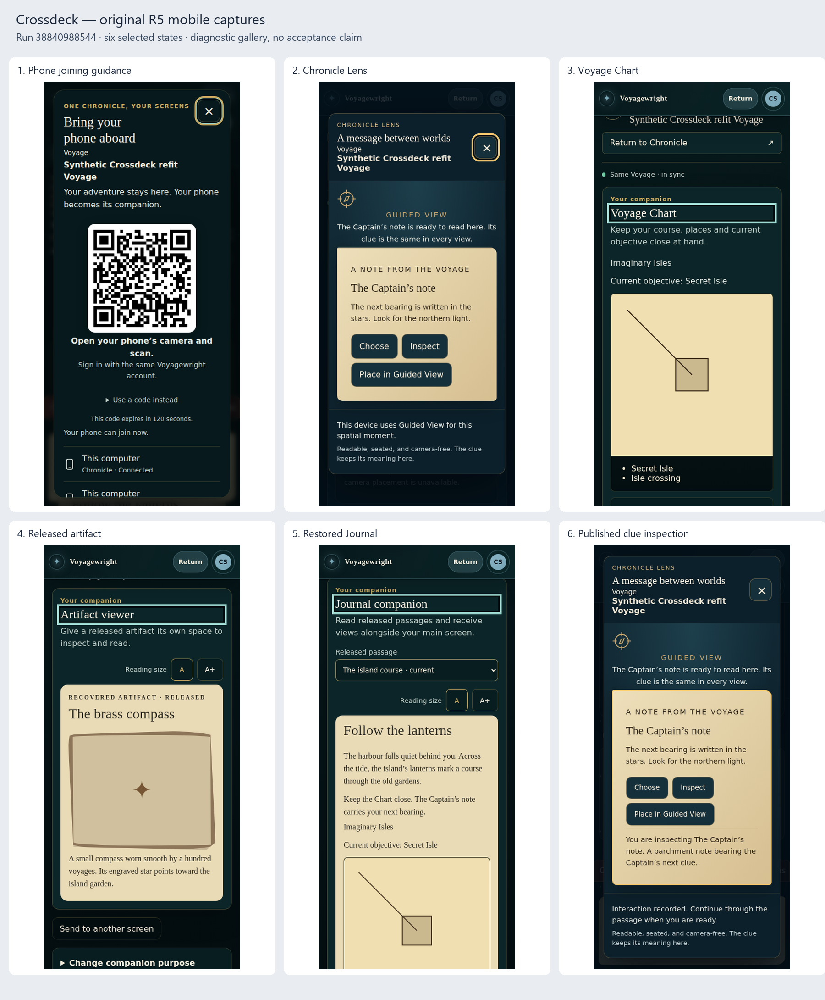

# Original capture gallery

This diagnostic contact sheet resizes six original screenshots from protected capture16
[run38840988544](https://github.com/Kgray44/treasurehuntSoT/actions/runs/38840988544).
The [index](gallery-index.json) binds every panel to its original identifier, path and SHA-256.
Final independent review6 is BLOCKED for missing fresh two-device joining and transfer/recovery evidence.
This gallery establishes no two-device behavior, physical-device result or owner acceptance.

Open each original at its native resolution:

- [1. Phone joining guidance](../../../../../Testing/Product_Experience/evidence/generic/crossdeck.phase2.continuity-contextual-connect-return-MOBILE-PLAYER-NORMAL-CONNECT_READY-3.png)
- [2. Chronicle Lens](../../../../../Testing/Product_Experience/evidence/generic/crossdeck.refit.companion-companion-purpose-return-MOBILE-PLAYER-NORMAL-LENS_READY-3.png)
- [3. Voyage Chart](../../../../../Testing/Product_Experience/evidence/generic/crossdeck.refit.companion-companion-purpose-return-MOBILE-PLAYER-NORMAL-CHART_READY-7.png)
- [4. Released artifact](../../../../../Testing/Product_Experience/evidence/generic/crossdeck.refit.companion-companion-purpose-return-MOBILE-PLAYER-NORMAL-ARTIFACT_READY-13.png)
- [5. Restored Journal](../../../../../Testing/Product_Experience/evidence/generic/crossdeck.refit.companion-companion-purpose-return-MOBILE-PLAYER-NORMAL-JOURNAL_RESTORED-16.png)
- [6. Published clue inspection](../../../../../Testing/Product_Experience/evidence/generic/crossdeck.refit.published-lens-published-clue-inspect-return-MOBILE-PLAYER-NORMAL-INSPECTED-6.png)

The complete evidence set contains 164 screenshots, 32 full recordings and 32 traces
across 32 contexts. Recordings/traces carry temporal behavior; this gallery is a visual entry point.
