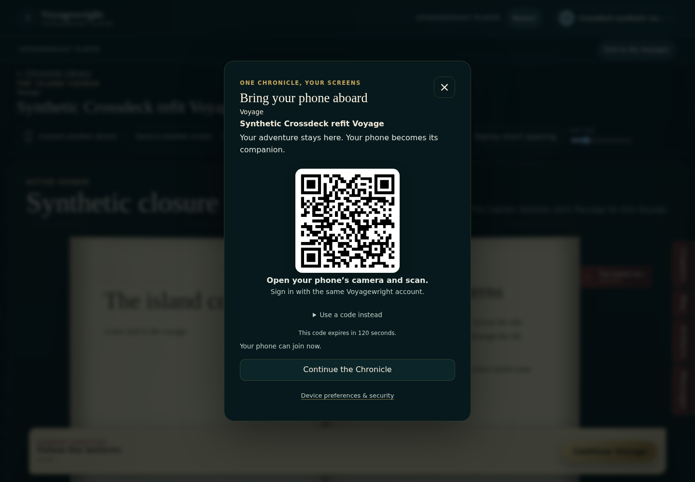
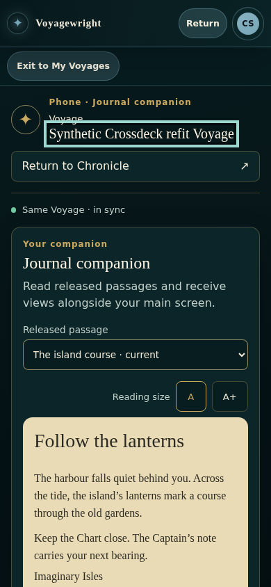
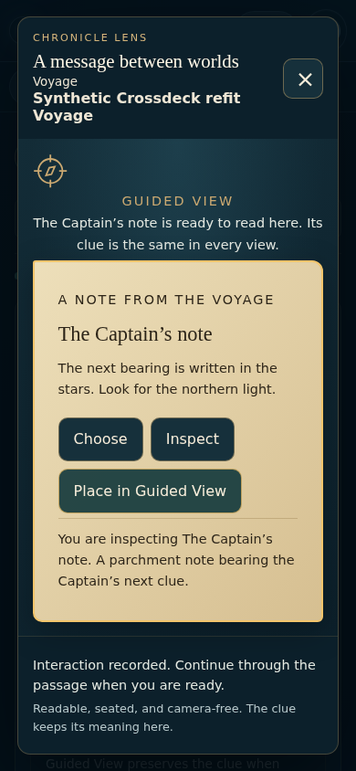
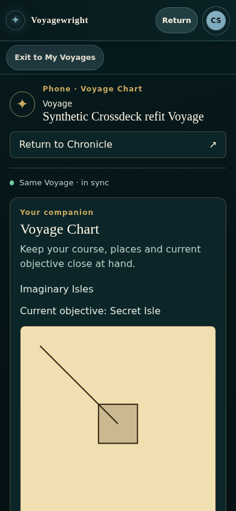
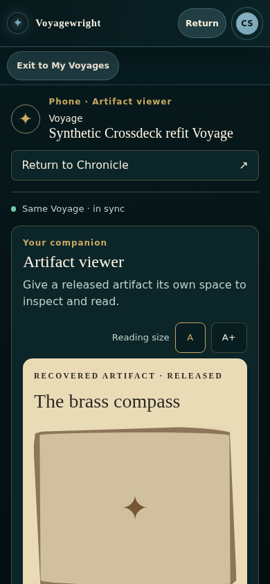
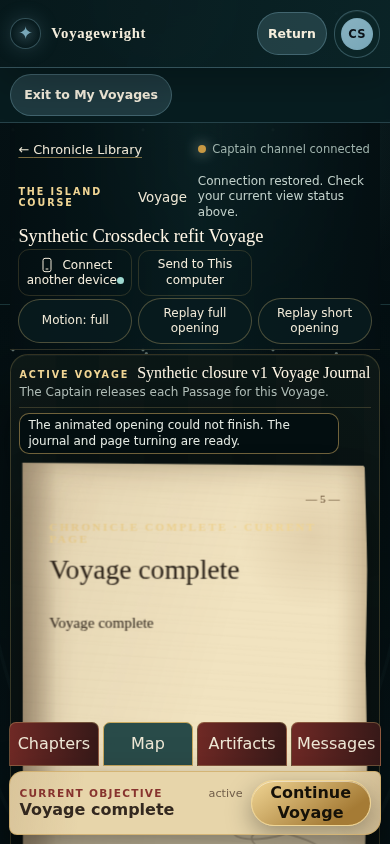

# Crossdeck on the main screen and phone

These are actual synthetic application captures from protected [preparation 18](https://github.com/Kgray44/treasurehuntSoT/actions/runs/38902634861). The complete fresh bundle contains 222 screenshots, 38 participating recordings and 38 traces across 32 generic and six paired contexts. The [R8 verification record](../../../Spatial_Experience_Refit_R8_Verification_20261016.md) records independent review and qualification separately. Physical/native and product-owner acceptance remain separate.

| Source binding      | Exact value                                                        |
| ------------------- | ------------------------------------------------------------------ |
| Candidate           | `3415165ed9c4c11f2512d99aea0947f62696146a`                         |
| Candidate tree      | `8069deb92f810deeafd9e1afa953abd18f15bc3a`                         |
| Protected base      | `151417a772c1bcde4e5c7f256302b803d25d40da`                         |
| Source digest       | `6d8ebc54902e7bce42a73c1e92d2ad6bc3465f94a1632c04559112bd3afee0ba` |
| Capture artifact    | `12048176159`                                                      |
| Original ZIP SHA256 | `00d3706a20bfb1c9ec9f60bf6daabd58a4c10a298dcc9512dc5845cabf36d754` |

The [preservation index](../preparation18/preservation-index.json) binds original and published bytes. Parsed metadata is formatted; raw report, witness, observation, runtime and media bytes retain their hashes.

## Connect inside the Chronicle

## Phone Journal companion

## Published clue in Guided View

## Dedicated phone Chart

## Released artifact

## Phone continuation with readable opening fallback

## Delivery, recovery and other viewports

| Actual state                  | Screenshot                                                                                                                                |
| ----------------------------- | ----------------------------------------------------------------------------------------------------------------------------------------- |
| Sender waiting for receipt    | [Open actual capture](../../../../../Testing/Product_Experience/evidence/generic/paired/refit-no-preference/09-transfer-pending.png)      |
| Receiver sees the offer       | [Open actual capture](../../../../../Testing/Product_Experience/evidence/generic/paired/refit-no-preference/09-receive-offer.png)         |
| Receiver opens the Chart      | [Open actual capture](../../../../../Testing/Product_Experience/evidence/generic/paired/refit-no-preference/10-chart-received.png)        |
| Sender sees acknowledgement   | [Open actual capture](../../../../../Testing/Product_Experience/evidence/generic/paired/refit-no-preference/10-delivery-acknowledged.png) |
| Phone reconnects              | [Open actual capture](../../../../../Testing/Product_Experience/evidence/generic/paired/refit-no-preference/12-reconnected.png)           |
| Main screen recovers the view | [Open actual capture](../../../../../Testing/Product_Experience/evidence/generic/paired/refit-no-preference/13-recovered-chart.png)       |
| Medium viewport Chronicle     | [Open actual capture](../../../../../Testing/Product_Experience/evidence/generic/paired/refit-no-preference/14-medium-chronicle.png)      |
| Phone landscape               | [Open actual capture](../../../../../Testing/Product_Experience/evidence/generic/paired/refit-no-preference/15-phone-landscape.png)       |
| Full Chronicle return         | [Open actual capture](../../../../../Testing/Product_Experience/evidence/generic/paired/refit-no-preference/16-return-to-chronicle.png)   |
| Revoked phone access          | [Open actual capture](../../../../../Testing/Product_Experience/evidence/generic/paired/refit-no-preference/17-access-ended.png)          |

## Original paired-device recordings

These six recordings belong to the participating main-screen and phone contexts. Helper-page clips are retained as supporting files and do not add device coverage. Normal/reduced recordings include joining, purpose switching, delivery, continuation and recovery; adverse recordings include expiry, private-send decisions, restricted crew content and revocation.

| Case                             | Device  | Original recording                                                                                                                              |
| -------------------------------- | ------- | ----------------------------------------------------------------------------------------------------------------------------------------------- |
| NORMAL / crossdeck-pair-normal   | DESKTOP | [Play or download](../../../../../Testing/Product_Experience/evidence/generic/paired/refit-no-preference/49c304573bb712ff6934429d315cbe5e.webm) |
| NORMAL / crossdeck-pair-normal   | MOBILE  | [Play or download](../../../../../Testing/Product_Experience/evidence/generic/paired/refit-no-preference/3fec9ddfb6f6a218c4cbea0162ff386f.webm) |
| REDUCED / crossdeck-pair-reduced | DESKTOP | [Play or download](../../../../../Testing/Product_Experience/evidence/generic/paired/refit-reduce/1688fae87e761c78dbbb5e9d9ff59439.webm)        |
| REDUCED / crossdeck-pair-reduced | MOBILE  | [Play or download](../../../../../Testing/Product_Experience/evidence/generic/paired/refit-reduce/1fb0bfde81262cab253f5dbdd8c3c467.webm)        |
| NORMAL / crossdeck-pair-adverse  | DESKTOP | [Play or download](../../../../../Testing/Product_Experience/evidence/generic/paired/refit-recovery/4e78c1b1388b8a59f44bc8667d85f4d2.webm)      |
| NORMAL / crossdeck-pair-adverse  | MOBILE  | [Play or download](../../../../../Testing/Product_Experience/evidence/generic/paired/refit-recovery/8eb7bce63ad74c91d8284def10ebcd74.webm)      |

All seven generated review packets and the combined capture manifest retain the complete state/device/role/motion mapping. A screenshot alone does not prove a transfer or canonical progress change; the original recordings, traces, paired receipts and database witnesses accompany those outcomes.
