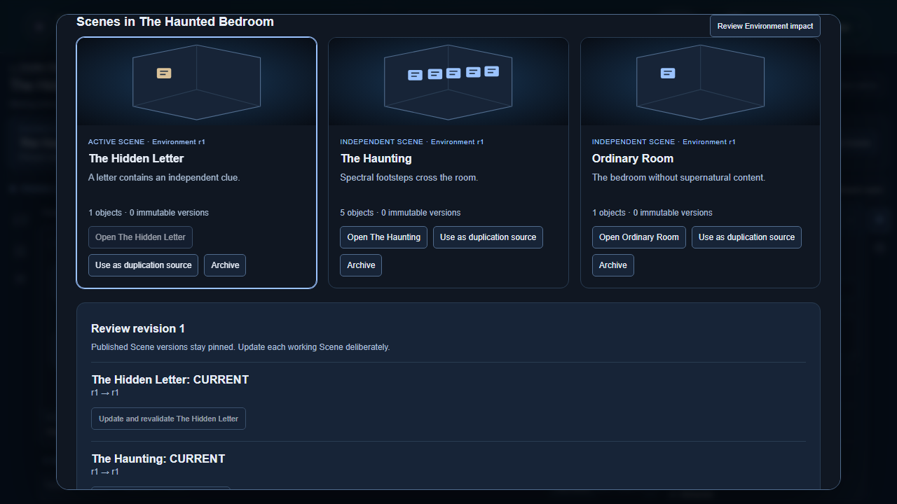
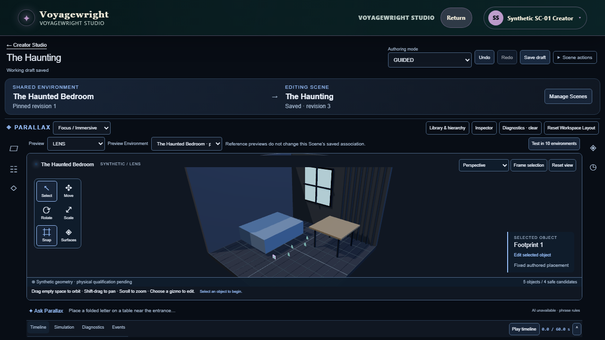

# Reusable Environments and independent Scenes

SC-01 extends the canonical Spatial Studio and reusable authoring store. An Environment owns shared room dimensions, architecture, furniture, semantic features, constraints and base lighting. A Scene retains its existing SpatialDraft identity and owns its objects, transforms, visibility, media, declarative behaviors and interactions.

This candidate is under focused and browser validation. It does not yet claim protected integration, visual completion, physical-device qualification or owner acceptance.

## Data and ownership

Environment records use the existing reusableAuthoringItem and reusableAuthoringItemVersion tables with kind PARALLAX_ENVIRONMENT. Every save claims the exact owner and revision, then appends an immutable checksummed version. Built-in references are immutable; editing creates a new owned copy. Reviewed reconstruction metadata can be imported through the same geometry schema without private images or credentials.

Scenes remain PARALLAX_STUDIO records. Optional version-content fields are environment, sceneDescription, environmentPlacements and scenePresentation. The last provides an independent INHERIT/NORMAL/LOW Studio preview lighting override; it does not control physical room illumination. Historical content omitting these fields retains its existing serialized material and checksums. Scene saves validate access to the exact Environment version. Neither saving a Scene nor saving an Environment rewrites sibling Scenes or released envelopes.

The Environment pin contains environmentId, versionId, revision and checksum. A Scene keeps that pin until the Creator explicitly reviews an update. Review reports changed room bounds, furniture, lighting and explicit semantic features, and rejects missing or unsafe references and invalid placement geometry. Updating is an ordinary undoable draft replacement; calibration claims are invalidated for re-review. Published Scene versions retain their original pins.

## Creator workflow

The context strip identifies the shared Environment, active Scene, editing scope and saved state. Manage Scenes opens one gallery with content-derived schematic thumbnails, names, descriptions and immutable-version counts. It supports baseline creation, existing-Scene duplication, rename, archive, switching, save, preview and information inspection. Existing Library publication and Chronicle attachment controls retain their authority.

The Environment editor clearly marks shared edits, supports its own Undo/Redo, and saves a new revision independently. The impact view offers a controlled per-Scene update. Archiving removes a working Scene from listings while preserving released versions and existing Chronicle pins.

Scene comparison uses Tideglass's stable-identity matcher and the canonical JSON utility as a bounded spatial projection. It distinguishes added/removed objects, transforms, visibility, content, behavior timing, interactions, media/effect dependencies and Environment/semantic-reference differences. Optional SC-02 element fields can be compared when that capability is integrated; this candidate does not invent renderer support.

## Future Chronicle Scene reference

The stable contract is exported from src/parallax/scene-reference.ts as SceneReference, sceneReferenceSchema, sceneReference and validateSceneReference. A reference requires:

- schemaVersion equal to 1;
- sceneDefinitionId, sceneVersionId and sceneChecksum bound to a validated immutable SpatialMoment;
- the exact Environment pin from that Scene version;
- behaviorIds from the same immutable Scene version;
- a transition intent of CUT or PRESERVE_ENVIRONMENT.

The [synthetic exported reference](evidence/sc-01/20261015-repair1/chronicle-scene-reference-example.json) was produced by the canonical exporter from the immutable Scene release created in the passing browser journey and validated against that release. It retains Environment revision 1 even though the working copy later moved to revision 2.

A publisher must retain all pins rather than substituting latest revisions. Validation rejects a mismatched Scene checksum, Environment pin or behavior set. PRESERVE_ENVIRONMENT is a future transition declaration; no transition runtime or SC-03 Story Block integration is implemented here. One Voyage continues to own progression, and existing Chronicle snapshots remain the immutable publication authority.

## Validation and demonstration

Thirty-four focused tests pass across Environment authoring, owner-scoped append-only persistence, existing Library persistence, authenticated API operations and Scene Manager concurrency. Another 85 existing authoring, publication, assets, native, transfer and Studio component regression tests pass. They cover the three independent Haunted Bedroom Scenes, supported timed reveal/highlight behavior, duplication, comparison, reference validation, conflicts, immutable pins and Undo/Redo. Initial worker-start failures and a subsequently fixed optional-field comparison defect were development findings, not qualification receipts.

The dedicated browser test authors The Haunted Bedroom, Ordinary Room, The Haunting and The Hidden Letter through visible Studio controls. It also exercises save/reload, switching, duplication, rename, behavior editing, comparison, Environment impact/update, keyboard entry and mobile accessibility. Both production-browser journeys pass. The Haunted Bedroom journey includes mobile serious/critical axe checks, keyboard focus restoration, natural Library return, invalid-geometry recovery, stale-save rejection and immutable-envelope readback. A second journey selects a built-in Environment, edits a separately owned copy, imports reviewed synthetic reconstruction metadata, creates Scenes from each source and duplicates another Scene without changing its Environment association. Both journeys verify persisted identities and reload. The actual captures and independent supporting review are linked below. Protected experience capture and ordinary qualification remain blocked as described below.

The renderer uses saved fixture geometry and semantic surfaces for pinned Environments, retaining the existing reference-room furniture for unbound previews. The context strip exposes both the pinned revision and any newer revision. Inactive Scene updates fetch current content before applying a pin; a focused concurrency test proves that a stale gallery snapshot cannot overwrite a newer edit. Comparison includes anchor-frame changes as well as object-local transforms.

Checked-in built-in envelopes have fixed pre-release numeric precision so production JSON serialization preserves their digests. An initial production capture found this serialization defect; the repair retained checksum verification and subsequent production builds and journeys passed. Earlier failed captures remain failed.

## Evidence and integration state

The [initial supporting evidence packet](evidence/sc-01/20261015-local/review-packet.json) binds source 2db81ec7, screenshots, focused checks and review scope. The [independent initial review](evidence/sc-01/20261015-local/independent-review.json) inspected all 17 dimensions and confirmed two interaction defects: stale rename state after opening an inactive Scene through impact review, and clipped tools on the short desktop canvas. Both were repaired with focused assertions and fresh production captures. The initial REPAIR_REQUIRED verdict remains preserved. These are local supporting artifacts and grant no protected experience or product acceptance.

The [repair capture packet](evidence/sc-01/20261015-repair1/review-packet.json) binds source adc5709b. Its fresh production build, TypeScript and complete browser journey pass. The browser verifies both inactive Scene titles after update, waits for the visible save confirmation before persistence readback, and proves that every editing tool fits above the short desktop canvas footer with a working Surfaces control. The first repair capture's premature test readback remains recorded as failed; the subsequent corrected journey passed. The [independent repair review](evidence/sc-01/20261015-repair1/independent-review.json) confirms both initial defects resolved and finds no new blocking regression within its bounded supporting scope. Protected experience, motion, full fallback, physical and owner acceptance remain unestablished.

The [source-selection receipt](evidence/sc-01/20261015-environment-sources/run.json) binds two passing journeys to source 2102942b, whose product source matches adc5709b. It adds direct observations of dirty state, Scene information, immutable built-in content, owned-copy identity, reconstructed Environment creation and source-Scene duplication.

The [semantic-control capture packet](evidence/sc-01/20261015-disclosures/review-packet.json) binds source a33780ae. Four native disclosure summaries now expose explicit button semantics. A fresh production build with TypeScript, both complete browser journeys and the focused Scene Manager component check pass. The browser activates shared features, reconstructed input and Scene information with Enter; identity opens and closes with the correct persisted values. The [third independent supporting review](evidence/sc-01/20261015-disclosures/independent-review.json) records all 17 dimensions, verifies both earlier reports unchanged and finds no new blocking finding within this scoped delta. It preserves repair iteration 2 and all previous failure history. Complete keyboard traversal, motion, assistive-technology use, adverse fallback and protected acceptance remain unestablished.

The [comparison contract receipt](evidence/sc-01/20261015-comparison-contracts/run.json) binds source c3c4b579, with product source unchanged from a33780ae. Two additional cases prove Tideglass identity for same-looking added/removed objects and independent Scene lighting overrides. Both cases and nine existing Environment authoring checks pass; changed-file lint and formatting pass. This is additional domain evidence and does not change the three supporting reviews or establish protected acceptance.

| Requested capability | Recorded proof and boundary |
| --- | --- |
| Shared identity, ownership and immutable revisions | Environment service tests exercise owner access, CAS, exact pin resolution, append-only versions and unchanged built-ins. Historical Scene fields remain optional. |
| Manager creation, save, switch, duplicate, rename, archive, preview and information | Both actual production journeys use the existing Library and Studio. Haunted Bedroom captures show independent objects/behavior and three shared Environment pins; dirty state and immutable information are observed. |
| Saved, built-in, new and reconstructed sources | The second journey proves all four sources and duplication from another Scene, including reload with the source pin. Reconstruction metadata is synthetic; accuracy is not claimed. |
| Geometry, semantic references and controlled revision update | Domain tests and the browser impact/recovery journey verify explicit review, per-Scene update, calibration invalidation, Undo/Redo and saved readback. |
| Scene comparison | Tideglass identity matching and focused tests cover the specified object, transform, visibility, lighting/effect, animation, interaction and Environment-reference categories. The browser opens the actual comparison. |
| Persistence and isolation | Recorded focused tests and browser readback cover stale-save rejection, independent identities, immutable releases, sibling isolation, render state and reload. |
| Future Chronicle binding | The exported schema validates the immutable synthetic Scene reference linked above; SC-03 and a transition runtime remain outside this change. |
| Protected integration | The trusted preflight receipt below is a failure. Fresh protected capture/review, ordinary PASS, protected merge and landed smoke remain open. |

The protected planner selects crossdeck.phase2.continuity through shared Parallax consumers and fails with PRODUCT_EXPERIENCE_EXPERIENCE_DESIGN_REQUIRED. Protected main at 4baa39af has only that contract's experienceIntent. The Crossdeck owner located the complete owning design in unmerged draft [PR #721](https://github.com/Kgray44/treasurehuntSoT/pull/721), checkpoint a98dad37, and confirmed it has no accepted rendered evidence. That separately owned refit still requires authorized capture. SC-01 preserves this obligation, does not adopt its unmerged implementation, and does not claim protected integration, visual completion or a landed-tree smoke test.

Protected-main [capture preparation 38681713940](https://github.com/Kgray44/treasurehuntSoT/actions/runs/38681713940) confirms the same design gate against candidate 421bbcdd and authority base 4baa39af. The [failed-run receipt](evidence/sc-01/protected-capture-38681713940/run.json) preserves its source identity and failure log. No new SC-01 capture/review or mainline decision was produced. The always-upload artifact is explicitly unusable as new accepted SC-01 provenance. Overnight coordination has resumed the owning Crossdeck prerequisite; the integration trigger is its protected landing, followed by current-main reconciliation and fresh qualification.

## Combined Studio compatibility

Read-only review of [SC-00 handoff bcbd76df](https://github.com/Kgray44/treasurehuntSoT/blob/bcbd76df/Development_Docs/Projects/Project_Parallax/SC_00_Integration_Handoff_20261015.md) identifies a required compatibility bridge before combining the branches. Its RoomEnvironment preserves yaw, modeled parts/supports, exclusions, construction and photo provenance beyond this candidate's fixture projection. Its Library lifecycle also distinguishes mutable version zero, CAS revision, immutable release ordinal, explicit WORKING/SAVED/LEGACY_REVIEW membership and recoverable archive.

The existing PR #722 owner implements that additive bridge in its own checkout; SC-01 reviews exact Scene pins, controlled source updates and isolation. The combined model must preserve lossless room content and both existing immutable envelope formats/checksums, use explicit owner-authorized conversion with lineage where required, and keep private provenance out of Assistant/publication projections. A catalog projection must never reconstruct richer geometry from fixture proxies. The combined Scene comparison must include canonical Studio animationTracks as well as the current behavior timing projection. This is a coordinated integration requirement, not a claim that the bridge or combined experience is already implemented or accepted. No parallel checkout was modified.

Feature Catalog: no fragment change while the branch remains unaccepted. The Environment/Scene capability is meaningful and becomes catalog-eligible only after its local acceptance and integration requirements pass.

All local source, dependencies, databases, temporary files and evidence reside on the task-owned D: worktree. The shared C: checkout, parallel Parallax worktrees and inspection runtimes are preserved.
