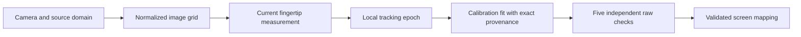
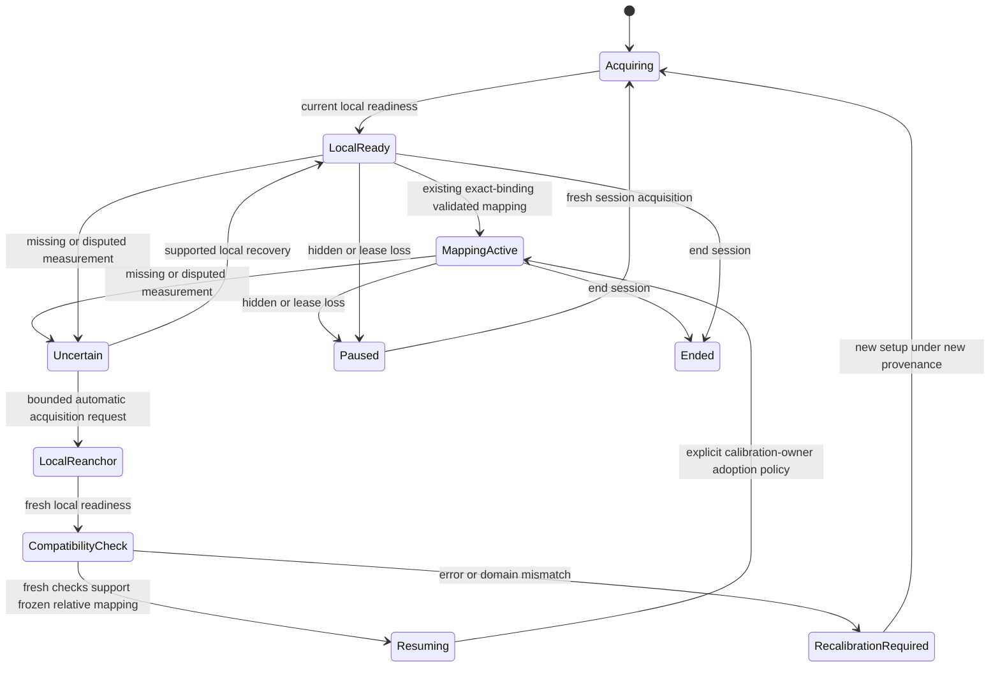

# Reach session recovery and calibration epochs

This bounded investigation establishes a useful separation between session, local measurement and calibration authority, but **does not establish safe automatic recovery**. Both generated copied-terminal perception negatives fail. The integration decision is **do not integrate**; the original application and preview remain preserved.

Research starts at draft PR #769 source `0b367b02f3852371fe82e43a1e6a5fcc36283716`, with current main inspected at `aaff919428ef9ab421579415ce3409949724760d`. The intervening main changes do not change Reach, Watchglass, Sextant or the inspected Reach governing sources. The mathematical audit and original proposal below were written before prototype implementation. The appended results record the bounded executions and independent challenge; they grant no production permission.

## Mathematical audit

Relative features are exactly `phi = [1, qx, qy, 0, 0]`, where `q` is the fused normalized camera-image measurement. [coordinates.ts](../../../src/reach/coordinates.ts) and the Laboratory's direct `relativeIndexFeatures(o.point)` call perform no subtraction of a tracking origin. The comfortable reference is learned during calibration, rather than reset when an optical template changes.

For the center, left, right, up and down holds, the existing relative fitter computes:

```text
cx = mean(qx at center); cy = mean(qy at center)
gx = 0.8 / (mean(qx at right) - mean(qx at left))
gy = 0.8 / (mean(qy at down) - mean(qy at up))
screenX = 0.5 + gx * (qx - cx)
screenY = 0.5 + gy * (qy - cy)
```

Logical identity is absent from these equations. This is mathematical epoch independence conditional on unchanged measurement meaning, not proof that a replacement measures the same endpoint. The existing tracker can change coordinate phase, anatomical offset and model-coordinate bias when references change.

Absolute features additionally contain the self-normalized index chord, with aspect correction and monocular inferred relative depth. The nine-target fit is ridge regression `W = inverse(Phi' Phi + 0.001 D) Phi' Y`, with an unpenalized intercept. It depends on observed tip and axis geometry; same-camera metadata cannot establish equal physical pointing bias for another finger. The prototype will not authorize absolute cross-epoch portability.

| Fitted or bound value           | Actual dependency                                                                                                                 | Reuse requirement                                                           |
| ------------------------------- | --------------------------------------------------------------------------------------------------------------------------------- | --------------------------------------------------------------------------- |
| Relative center/intercepts      | Original comfortable center in image coordinates                                                                                  | Same coordinate meaning, or separately established transform                |
| Relative X/Y gain               | Original movement spans; sign is retained                                                                                         | Same scale, orientation and usable movement domain                          |
| Absolute coefficients           | Nine groups of tip/axis features and target labels                                                                                | Independently supported full feature equivalence; outside this prototype    |
| Feature bounds/supported region | Original observed coverage and central 80% screen region                                                                          | Never expand from new ID or successful center alone                         |
| Residuals/jitter                | Original raw groups and frozen mapping                                                                                            | Historical evidence remains under original provenance                       |
| Validation P95/uncertainty      | Five distinct raw held-out groups and viewport diagonal                                                                           | New measurements need independent checking; old validation is not inherited |
| Expiry                          | Original creation plus thirty minutes                                                                                             | No renewal merely because a new track appears                               |
| Binding                         | Provider/version/digest/generation, lease/frame, viewport, mirror/orientation, track/generation, evidence tier and feature family | Exact comparison remains mandatory in the current owner                     |
| Image domain                    | Above image producer context plus native dimensions                                                                               | Equal metadata is necessary, not sufficient endpoint equivalence            |

For example, an image span of 0.1 produces gain 8. A new measurement bias of only 0.01 shifts screen X by 0.08, which is 5.66% of a square viewport diagonal. The camera can be unchanged while the 3% raw error gate fails. Scale and rotation changes create different errors; recentering alone cannot repair them. Mixing individually stable targets from two biased epochs can corrupt the learned span.

A known invertible coordinate transform `qNew = T(qOld)` could support `fNew = fOld composed with inverse(T)`. This investigation will not estimate such a transform from checking targets, nor assume one. It tests a frozen relative mapping on fresh measurements, and rejects unsupported offsets, scales, rotations and extrapolation.



At C→I, geometry, mirror/orientation and source must remain compatible. At I→M, the endpoint and measurement bias must remain supported. M→E records provenance without claiming biometric identity. E→F cannot merge incompatible raw groups. F→V freezes coefficients, bounds and expiry; checking data cannot fit an alignment. V→S is an explicit calibration-owner decision, not a consequence of local readiness.

## Current deadlocks and ownership

The canonical tracker already cold-acquires local tracks and assigns generations. Naming another generation is not a new capability. Two actual stalls remain: same-hand association can stay alive while coordinate evidence never recovers, and the Laboratory preserves a replacement's completed targets in an `identityHold` which only the original binding can release. The latter is a deliberate protection, not a mathematical proof that every software-ID change alters coordinates.

`TemporalIndexTrack` retains local continuity; `IndexSourceAssociation` owns source association; `IndexImageTracker` owns accepted current measurements; `IndexImageReadiness` owns stabilization. `SampleWindow` and the existing calibration fitter/checker remain the evidence and numerical owners. A research session coordinator will own only transition ordering, acquisition tokens and dispositions of references to those owners. It will not create a second raw-sample ledger or a competing tracker.

## Proposed experiment

A session may contain multiple acquisition epochs. No new epoch asserts that it is the original physical finger. An automatic-only reacquisition command may clear the local selection through the existing runtime API; it cannot restart the camera, alter its lease, abandon a manual selection, revive old results or transfer aliases. A monotonically increasing session token and capture cutoff reject callbacks from a closed epoch. Source changes, hidden/ended sessions and stale captures withdraw permission.



The coordinator's research result cannot implement the Resuming→MappingActive production adoption arrow. That requires the separately reviewed binding policy. No timer or new ID grants that permission.

| State                    | Evidence/transition                                            | Display and actions                                       | Calibration/evidence                                                   | Expiry, invalidation and feedback                                       |
| ------------------------ | -------------------------------------------------------------- | --------------------------------------------------------- | ---------------------------------------------------------------------- | ----------------------------------------------------------------------- |
| Acquiring/local reanchor | Current automatic canonical acquisition, new token             | Camera-space feedback only; no action                     | Old evidence retained inert; new samples partitioned                   | Bounded attempt; stale/foreign callbacks rejected; “Finding your point” |
| Local ready              | Current local readiness                                        | Camera-space preview only; no calibrated cursor/action    | New evidence stays under current epoch                                 | Readiness is not mapping authority                                      |
| Mapping active           | Current local readiness and applicable exact binding           | Existing permitted display only; no new gesture authority | Existing owner may collect same-epoch eligible samples                 | Freshness and source fences retained                                    |
| Uncertain                | Lost current permission                                        | No new authoritative position/action                      | Pause unfinished window; preserve completed groups                     | Same-epoch recovery or bounded reacquisition                            |
| Compatibility check      | New local epoch, frozen relative fit and fresh held-out groups | Explicitly provisional feedback; no old validated cursor  | Five new groups, each at least 15 samples/600 ms; no old-group pooling | Reject source/geometry changes, expiry, incomplete or failed raw checks |
| Resuming                 | Separate successful compatibility proposal                     | No authority from research result alone                   | Old record unchanged; proposed lineage retains both epochs             | Requires reviewed adoption policy, never inherited identity             |
| Recalibration required   | Incompatible/unsupported domain                                | Limited truthful feedback and conventional controls       | Preserve old record; start separately bound new setup                  | No repeated automatic reset loop                                        |
| Paused/ended             | Visibility, lease or session end                               | No output/action                                          | No current collection                                                  | Tokens revoked; ended sessions cannot resurrect                         |

Transitions are synchronous, idempotent under duplicate inputs and emit bounded research reason codes. Rejected inputs cannot mutate newer state. The prototype carries no live telemetry, camera access, application consumer or action callback.

## Frozen evaluation and decision boundaries

Use one isolated session prototype, one relative compatibility evaluator and existing canonical tracking/calibration classes. C-hosted private output is capped at 32 MiB; no installs, copied recordings, new model, full build or capture is needed. Preserve the old transplanted-tip fixture and original failed receipt rather than editing its requirement.

Evaluate: same-epoch pause/resume; fresh unrelated epoch acquisition; stale/foreign/closed-token rejection; manual-selection protection; source/geometry invalidation; repeated transitions; interrupted holds and retained groups; frozen relative mapping with equivalent coordinates; biased/scaled/rotated coordinates; exact raw 3% boundary; incomplete or reused checking targets; expiry; unsupported absolute reuse; and the transplanted-terminal sequence against both uninterrupted and cold-reset canonical tracking. The last comparison must report any false local position separately from old-calibration authority. A new epoch must never make that candidate actionable using the original calibration.

Compare local acquisition, physical association, calibration compatibility and session continuation separately. Report target counts and fresh checks; do not turn generated labels into physical ground truth. Benchmark added transition CPU and bounded state, not inference or hand-to-display latency. No reserved controls or repeated threshold sweeps are needed.

The product integration decision follows the adversarial results and independent review. A partial mathematical or research outcome is permitted; it is not improved physical tracking. Any production adoption requires relevant browser/recorder/performance checks and current governing approval. The current application, failed mixed-motion assertion, existing preview and protected requirements remain unchanged until then.

## Governance status

The governing document already calls track IDs ephemeral rather than biometric and permits independently validated calibration reuse in principle. It also requires fresh identity/intent, binds selected operations to track generation and forbids silent continuation after identity loss. This proposal does not resume an earlier operation or reinterpret those requirements.

Research is authorized by the new owner directive. Production cross-epoch rebinding is not authorized by this document. A separate proposal will identify the exact existing requirements, proposed confirmation/binding semantics, unchanged limits, required tests and owner decision before any such application change.

## Implemented research and reproducibility

The isolated source lives in [scripts/reach/research/session-epochs-20261021](../../../scripts/reach/research/session-epochs-20261021/). It is outside production imports and default unit-test discovery. No existing production test, assertion or test configuration was changed.

| Source                                                                                                                                                 | Interface and responsibility                                                                                                                                                                                                   |
| ------------------------------------------------------------------------------------------------------------------------------------------------------ | ------------------------------------------------------------------------------------------------------------------------------------------------------------------------------------------------------------------------------ |
| [pointing-session-epoch.ts](../../../scripts/reach/research/session-epochs-20261021/pointing-session-epoch.ts)                                         | `ResearchPointingSession`, `SessionMeasurementDomain`, `SessionEpochToken`, `SessionEpochSnapshot`; coordinates current canonical readiness, source fences, bounded acquisition command and permission disposition. Version 1. |
| [calibration-epoch-compatibility.ts](../../../scripts/reach/research/session-epochs-20261021/calibration-epoch-compatibility.ts)                       | `evaluateRelativeEpochCompatibility(RelativeEpochCompatibilityRequest)` returns a `RESEARCH_NUMERICAL_PROPOSAL`, counts and raw numerical error, never a calibration record, identity certificate or action token.             |
| [pointing-session-epoch.experiment.ts](../../../scripts/reach/research/session-epochs-20261021/pointing-session-epoch.experiment.ts)                   | Twenty generated controller cases, including parameterized domain invalidations.                                                                                                                                               |
| [calibration-epoch-compatibility.experiment.ts](../../../scripts/reach/research/session-epochs-20261021/calibration-epoch-compatibility.experiment.ts) | Eighteen mathematical/provenance checks using the canonical sample window, fit and checker.                                                                                                                                    |
| [session-epoch-perception.experiment.ts](../../../scripts/reach/research/session-epochs-20261021/session-epoch-perception.experiment.ts)               | Four cases through the actual public image tracker, observation gate and readiness owner; two retained failing perception falsifiers.                                                                                          |
| [run-research.mjs](../../../scripts/reach/research/session-epochs-20261021/run-research.mjs)                                                           | Explicit generated-only runner, source pins, 42-test denominator, 45-second inner/60-second owner deadlines, 32 MiB output cap and 64 KiB logs; reports test and cleanup outcomes separately.                                  |

With the existing locked dependencies already installed, invoke from the repository root:

```text
node scripts/reach/research/session-epochs-20261021/run-research.mjs --output <new absolute directory outside the repository>
```

This suite currently exits **1** because two safety assertions fail. It does not skip, invert or mark those failures as expected passes. The directory must be new; the runner does not overwrite retained results or install packages. It pins its source before and after execution and uses the existing creation-bound process owner. A successful cleanup receipt is not a successful test suite.

The first 42-case run remains immutable with its original source copies, result and owner receipt. Before publication, the five new research files moved from an initially isolated `src/reach/research` directory to the explicit research directory. An inverse comparison verifies only import-path/research-registration annotation changes. A successor adds bounded counts and identity comparisons to the uninterrupted failure message; pixels, capture times, expectations and algorithm behavior are unchanged. The public-source reproduction ran once after that relocation and diagnostic change. Publication formatting then wrapped one import and added its trailing comma; the executed preformat source is retained, and a final run binds the formatted source exactly. All three executions report **40/42 passing, two failing, zero pending/todo**, repeating the same 42 cases rather than providing 126 independent cases. Their owners report trees reaped and streams closed, with `escalated: true` cleanup retained separately from the failed suite. The [public aggregate](evidence/session-epochs-20261021/aggregate.json) records source and retained-receipt hashes without private recordings, runtime paths or owner coordinates.

The controller emits one automatic acquisition request after 1,200 ms of coordinate absence. There is no application consumer executing that request. It protects manual selection, gives acquisition its own fixed deadline, rejects stale/forged/closed-epoch tokens, preserves the oldest-pixel clock, and latches failed compatibility. It never grants action permission. A same-epoch mapping preview still uses the exact existing calibrated binding; replacement epochs get no old mapping. A pure compatibility evaluator cannot authenticate a producer: its provenance fields are claims supplied by the existing owner, not independent image proof.

The state diagram is broader than this prototype. Application feedback, deployed telemetry, paused-session restart, fresh setup orchestration and adoption arrows remain proposals. Research reason codes are not a deployed user interface. No second tracking engine, raw-sample store, camera consumer or interaction authority was added.

## Executed outcomes and decisive failures

| Obligation                     | Observed result                                      | Meaning                                                                                                                                                                                                                                                                                                                             |
| ------------------------------ | ---------------------------------------------------- | ----------------------------------------------------------------------------------------------------------------------------------------------------------------------------------------------------------------------------------------------------------------------------------------------------------------------------------- |
| Session coordinator            | 20/20 generated cases pass                           | Permission partition, stale/lifecycle rejection and retained references work under supplied observations; no live recovery demonstrated.                                                                                                                                                                                            |
| Relative compatibility         | 18/18 cases pass                                     | Equivalent frozen coordinates can pass; bias, scale, rotation, stale/mixed groups, source changes and unsupported absolute reuse are rejected. Numerical proposal only.                                                                                                                                                             |
| True-terminal comparison       | One positive comparison case passes                  | Cold acquisition emits a new logical track, non-null points match the generated terminal, and the final capture is readiness eligible. The comparison also checks every emitted uninterrupted point against that terminal. No exact positive-arm counts are published because the JSON reporter did not retain its console summary. |
| Old-fit binding denial         | One case passes for both actual replacement bindings | Canonical `calibratedPoint` rejects the original fit on cold replacement bindings and leaves the old record unchanged. Generated calibration groups are independent of the rendered stem; this is not an end-to-end calibration journey.                                                                                            |
| Copied terminal, uninterrupted | **FAIL: 4/9 points, 0/9 readiness eligible**         | All four published points retain the original logical ID and generation. The first appears at generated capture 833 ms, 333 ms after the return block begins. The later readiness assertion is not reached; the preserved diagnostic observes zero eligible frames.                                                                 |
| Copied terminal, cold reset    | **FAIL: 7/9 points, 2/9 readiness eligible**         | First point at 633 ms: three return captures spanning 133 ms. Readiness at 966 and 1,033 ms; the first spans eight return captures/466 ms. Reset is not the sole cause because the uninterrupted arm also emits false points.                                                                                                       |

These are four semantic arms of one generated renderer, not four independent physical trials. The return block has nine fixed captures from 500 to 1,033 ms. The copied control retains the proximal/body evidence and moves an overlapping terminal texture patch; it is an analytic unsupported terminal, not a separately filmed wrong finger or detached hand silhouette. Binding-test repetitions do not increase the independent denominator.

The failure is stronger than a calibration-ID mismatch. The uninterrupted false points retain the old software identity, so an exact ID comparison alone cannot certify their endpoint. That arm remains readiness-ineligible in this finite block; this investigation does not claim it produced an actionable calibrated cursor. The cold arm reaches readiness despite the false terminal. Therefore canonical `TRACKING` or local `READY` alone cannot discharge the new architecture's prerequisite of independently trustworthy current index localization. Old calibration denial protects one boundary without repairing perception.

No physical cross-epoch association is claimed or attempted by the prototype: `PhysicalAssociation` remains unclaimed. There is no production calibration adoption or action permission, even after a passing numerical proposal. Five screen checks can measure error of a frozen mapping; they do not certify anatomical index identity or rule out a nonlinear error between those five locations. No fitted epoch transform is implemented or independently validated.

## Calibration progress and measurement limits

The central mathematical result is conditional: logical track identity is absent from the fitted equations, but endpoint measurement meaning remains necessary. Equal camera metadata is insufficient. The compatibility fixtures use five distinct checks of sixteen fresh samples each (80 total), each spanning 750 ms with generated pixel age 5 ms. Under the source equations and an 800×600 viewport, ideal equivalence gives approximately 0% error; constant +0.08 X bias gives 6.4%; centered scale 1.2 gives 5%; and 90-degree rotation gives 40% of the diagonal. These values are **analytical expectations from the fixture equations**, not additional logged execution measurements. The tests execute the canonical raw-error gate and assert dispositions; no new exact-3% boundary experiment was executed.

The target-three training deadlock remains unresolved. With only two completed old training groups, there is no complete old fit for frozen-fit checking. This prototype retains those groups inert and can complete a separately bound generated setup of five new training groups and five new checks. It does not reuse an individual old target, continue the original active target, or reduce repeated target work. Ten new groups in that fixture are fresh setup work, not recovered progress. Its synthetic coordinates are not measurements from a camera-to-calibration journey.

| Requested measure                     | Evidence in this investigation                                                                                                                                                          |
| ------------------------------------- | --------------------------------------------------------------------------------------------------------------------------------------------------------------------------------------- |
| Local acquisition/time                | Generated true-terminal cold acquisition and final readiness pass; copied control also falsely acquires. Generated capture spans above are not wall-clock or physical recovery latency. |
| Original physical association         | Unclaimed; no success percentage or physical identity labels available.                                                                                                                 |
| Valid/rejected reuse                  | Eighteen numerical cases pass their expected dispositions; old replacement-binding denial passes. No adopted calibration reuse.                                                         |
| Destructive resets/recoverable pauses | Controller fixtures retain references and bound command count; no measured reduction in application resets or real pauses.                                                              |
| Time to calibration resume            | No production resume or adopted mapping; unavailable.                                                                                                                                   |
| Completed/repeated targets            | Fresh generated five-training/five-check setup passes while old groups remain unchanged; old-target reuse and saved work improvement are unproved.                                      |
| Full calibration/independent error    | Numerical fixtures only; no full physical calibration completion or new independent physical error measurement.                                                                         |
| Incorrect cursor/action eligibility   | Copied-control local false points counted above; no action callback exists and no new action permission is granted. No physical false-cursor rate measured.                             |

The retained 1,336-observation baseline remains 504 positions, 416 ready observations, seven logical replacements and RIGHT 13/89, with the original broad mixed-motion assertion failed. It was not rerun here and is not a before/after gain from this architecture. The earlier 191-frame diagnostic was not replayed either. These historical replay counts are not physical accuracy.

## Resource cost and verification scope

A generated Node benchmark uses 2,000 warmup and 30,000 measured controller observations in thirty batches of 1,000. Median batch mean is 0.0019679 ms per observation; P95 **of batch means** is 0.0027103 ms, and the maximum batch mean is 0.0031027 ms. It includes packet/snapshot allocation, provenance checks, readiness and state transitions. The post-GC whole-process heap changes from 12,823,408 to 12,784,280 bytes (−39,128 bytes); that noisy process delta is neither an object-size bound nor leak proof. The source hash stays unchanged, the final state is local-ready and action permission is false. The [portable benchmark source](../../../scripts/reach/research/session-epochs-20261021/benchmark-transitions.mjs) preserves those inputs; its path-only publication successor is distinguished from the executed private driver in the aggregate.

There is no neural inference, NCC, camera, browser, GPU/CPU comparison or capture-to-visible latency measurement in that benchmark. No new throughput or application performance improvement is claimed. No full build or new capture was made under the workstation's storage reserve. The unsafe acquisition prerequisite also prevents a new candidate from entering browser/recorder/product qualification; these checks are unexecuted, not passed by isolation.

Strict scoped TypeScript checking initially found four prototype typing errors. The original failure is retained; annotation-only corrections pass, including after relocation with five research roots and 21 canonical imported source files. Syntax, scoped lint/format, documentation and feature-catalog validation are publication checks, distinct from the failed 42-case research suite. No application source or default test configuration changes.

## Independent challenge and final disposition

Independent mathematical, pipeline and authority reviewers challenged the premise before implementation. Corrections included keeping local readiness separate from mapping authority, an independent acquisition deadline, protecting manual intent, rejecting late-ready callbacks even without a timer tick, and preventing old callbacks or failed checks from reopening newer state. Review then required the uninterrupted copied-terminal comparison, actual public readiness, exact old-fit denial and preserved negative assertions. The diagnostic successor establishes that uninterrupted false points retain the old software identity.

The final architecture challenge rejects a claimed usable recovery result: the target-three partial fit cannot use the proposed frozen-fit path; a transition command has no application executor; and local readiness is not independently reliable in the copied control. Naming epochs does not repair those defects. The reviewers accept the mathematical/permission partition as useful isolated research, not a production-ready implementation. Their findings and unresolved prerequisites are retained here and in the [separate unapproved amendment](Session_Epoch_Binding_Amendment_Proposal_20261021.md).

| Stage                                       | Disposition                                                                                                                                                              |
| ------------------------------------------- | ------------------------------------------------------------------------------------------------------------------------------------------------------------------------ |
| A — mathematics/governance                  | Completed audit before code; conditional invariance, provenance and authority boundaries identified.                                                                     |
| B/C/D — epoch, compatibility and controller | Isolated partial prototypes; no physical association, production adoption or application recovery.                                                                       |
| E — adversarial comparison                  | Two decisive failures retained; complete requested scenario matrix not executed.                                                                                         |
| F — integration                             | **Rejected for current candidate.** No production change or implementation approval requested.                                                                           |
| G — development verification                | Focused generated execution, strict source checks, cost measurement and independent review; product/browser/recorder/physical qualification unperformed.                 |
| H — publication                             | Research source, aggregate, report, proposal and navigation prepared for existing draft PR #769. Publication is verified separately at handoff. No protected-main merge. |

Separate wrong-digit, alternate-hand, face/background drift, periodic textures, distal loss, cropped palm/wrist, finger crossings/touching digits and full-hand-to-finger-only physical scenarios were not newly executed in this investigation. Existing historical failures remain preserved, but are not credited as new epoch coverage. Real target-hold/check/playground interruptions, source changes during actual camera use, repeated natural recovery and independent physical accuracy remain qualification work for a future safe candidate. No additional owner recording is requested; this conclusion uses the available corpus.

The bounded result is **partial mathematical and architectural progress with a negative integration decision**. The existing preview source `2d03e6678c7af0d08775c67ea9afffa79e2f9ac2` is not replaced by this work. This result rejects the current reset/readiness prerequisite; it does not prove that every possible epoch architecture is impossible. Reach Phase 1 reliability, useful automatic calibration continuation and owner physical acceptance remain open; Phase 2 has not begun.
